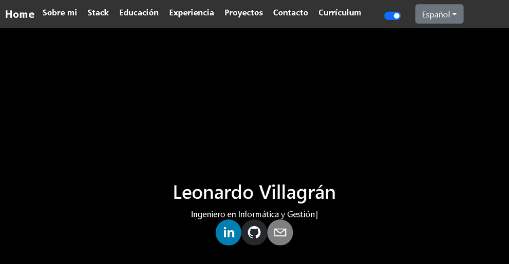

# Portfolio TS — Leonardo Villagrán

Portafolio bilingüe (ES/EN) con React 19 + TypeScript + Vite. Todo el contenido es editable sin tocar código, vía archivos JSON.

**Demos:**
- Netlify: https://leonardo-villagran-portfolio-ts.netlify.app/
- Render: https://portfolio-ts-wkho.onrender.com/



## Índice

1. [Arranque rápido](#1-arranque-rápido)
2. [Dónde editar cada cosa](#2-dónde-editar-cada-cosa)
3. [Cambiar links del CV](#3-cambiar-links-del-cv)
4. [Idiomas ES/EN](#4-idiomas-esen)
5. [Formulario de contacto (EmailJS)](#5-formulario-de-contacto-emailjs)
6. [Scripts y puertos](#6-scripts-y-puertos)
7. [Docker](#7-docker)
8. [Deploy](#8-deploy)
9. [Estructura del proyecto](#9-estructura-del-proyecto)

---

## 1. Arranque rápido

```bash
git clone https://github.com/Leonardo-villagran/portfolio-ts
cd portfolio-ts
npm install
cp .env.example .env   # y rellena las 3 claves de EmailJS (ver punto 5)
npm run dev
```

Abre http://localhost:4173/

> En Windows puedes usar `dev.bat` (mata el proceso anterior en :4173, arranca `npm run dev` y abre el navegador).

## 2. Dónde editar cada cosa

Todo el texto vive en `public/json/`. Hay un archivo por sección y por idioma (`*_en.json` = inglés).

| Quiero cambiar... | Archivo ES | Archivo EN |
|---|---|---|
| Menú + botón CV | `public/json/menu.json` | `public/json/menu_en.json` |
| Home (nombre, roles, LinkedIn, GitHub, email) | `public/json/home.json` | `public/json/home_en.json` |
| Sobre mí | `public/json/about.json` | `public/json/about_en.json` |
| Habilidades / Stack | `public/json/skills.json` | `public/json/skills_en.json` |
| Experiencia | `public/json/experiences.json` | `public/json/experiences_en.json` |
| Educación | `public/json/education.json` | `public/json/education_en.json` |
| Proyectos | `public/json/projects.json` | `public/json/projects_en.json` |
| Contacto (etiquetas del formulario) | `public/json/contact.json` | `public/json/contact_en.json` |
| Idiomas activos | `public/json/app.json` | — |

Ejemplo (`home.json`):

```json
{
  "name": "Leonardo Villagrán",
  "roles": ["Ingeniero en Informática y Gestión", "Data Scientist"],
  "linkedin": "https://www.linkedin.com/in/leonardo-villagran/",
  "github": "https://github.com/Leonardo-villagran",
  "email": "leonardovillagranchicago@gmail.com"
}
```

Reglas:
- Edita siempre el par ES + EN para que no queden textos mezclados.
- Es JSON estricto: respeta comas y comillas dobles.
- Los cambios en `public/` se ven con recarga automática (no requieren rebuild en `dev`).

Imágenes: `public/images/` (ej: `public/images/about/profile.jpg` es la foto del Home).

## 3. Cambiar links del CV

Hay un único punto de verdad por idioma. Los 3 botones (menú, Home y Contacto) leen de ahí automáticamente.

- Español → `public/json/menu.json` → `resume.link`
- Inglés → `public/json/menu_en.json` → `resume.link`

```json
"resume": {
  "title": "Currículum",
  "link": "https://drive.google.com/file/d/TU_ID_ES/view?usp=sharing"
}
```

Valores actuales (2026):

| Idioma | Link |
|---|---|
| ES | https://drive.google.com/file/d/1VCEHmb_qvZMA5vTpRAAoGzt15bgO93Dh/view?usp=sharing |
| EN | https://drive.google.com/file/d/1wQ7RaVkbr0nZFrOPurQGEZK2Uh4dQC2G/view?usp=sharing |

> Para que el link sea público: en Drive → Compartir → "Cualquier persona con el enlace puede ver".

Los componentes que lo usan (no necesitas editarlos): `src/components/Menu.tsx`, `src/pages/Home.tsx`, `src/pages/Contact.tsx`.

## 4. Idiomas ES/EN

`public/json/app.json` controla si aparece el selector de idioma:

```json
{
  "portfolioLanguages": { "spanish": true, "english": true }
}
```

- Ambos en `true` → aparece el dropdown ES/EN.
- Uno en `false` → se oculta el selector y queda un solo idioma.

El idioma elegido se guarda en `localStorage`.

## 5. Formulario de contacto (EmailJS)

1. Crea cuenta en https://www.emailjs.com/ y obtén Service ID, Template ID y Public Key.
2. Copia `.env.example` a `.env` y rellena:

```dotenv
VITE_SERVICE_ID=tu_service_id_aqui
VITE_TEMPLATE_ID=tu_template_id_aqui
VITE_USER_ID=tu_public_key_aqui
```

3. Reinicia `npm run dev` (Vite solo lee el `.env` al arrancar).

El `.env` real no se sube a git (está en `.gitignore`). En producción define las mismas 3 variables en Netlify / Render / Docker (ver puntos 7 y 8).

## 6. Scripts y puertos

| Comando | Qué hace |
|---|---|
| `npm run dev` | Desarrollo en http://localhost:4173/ |
| `npm run build` | Compila TypeScript + Vite a `dist/` |
| `npm run preview` | Sirve `dist/` localmente |
| `npm run serve` | Alias de `preview` (usado en Render) |
| `npm run lint` | ESLint |
| `npm run deploy` | Build + publica en GitHub Pages (`gh-pages -d dist`) |

Puerto fijo: `4173` (configurado en `vite.config.ts` con `strictPort`).

## 7. Docker

```bash
docker compose up --build
```

- Usa `Dockerfile` (Node 22-alpine, build + `preview` en :4173).
- `docker-compose.yml` mapea `4174:4173` y carga variables desde `.env`.
- Abrir: http://localhost:4174/

## 8. Deploy

**Netlify:** conecta el repo → Build command `npm run build` → Publish directory `dist` → agrega las 3 vars `VITE_*` en Site settings.

**Render:** New → Web Service desde el repo → Runtime Node → Build `npm install && npm run build` → Start `npm run serve` → agrega las 3 vars `VITE_*` en Environment Variables.

**GitHub Pages:** `npm run deploy` (requiere `homepage` en `package.json`, ya configurado).

## 9. Estructura del proyecto

```
portfolio-ts/
├── public/
│   ├── json/            # ← TODO el contenido editable (ES + *_en)
│   └── images/          # fotos, capturas
├── src/
│   ├── components/      # Menu, SocialIcons, Typewriters...
│   ├── pages/           # Home, About, Skills, Experiences, Education, Projects, Contact
│   ├── context/         # idioma (ES/EN) + tema (dark/light)
│   ├── interfaces/      # tipos TS por sección
│   ├── assets/css/      # estilos por página
│   ├── App.tsx          # rutas (/, /about, /skills, /experiences, /education, /projects, /contact)
│   └── main.tsx
├── .env.example         # plantilla de EmailJS
├── Dockerfile / docker-compose.yml
├── dev.bat              # arranque rápido en Windows
└── vite.config.ts       # base '/', puerto 4173
```

**Stack:** React 19, TypeScript, Vite 7, React Router 7, React Bootstrap + MUI, Axios, EmailJS, Typewriter, React Chrono.
